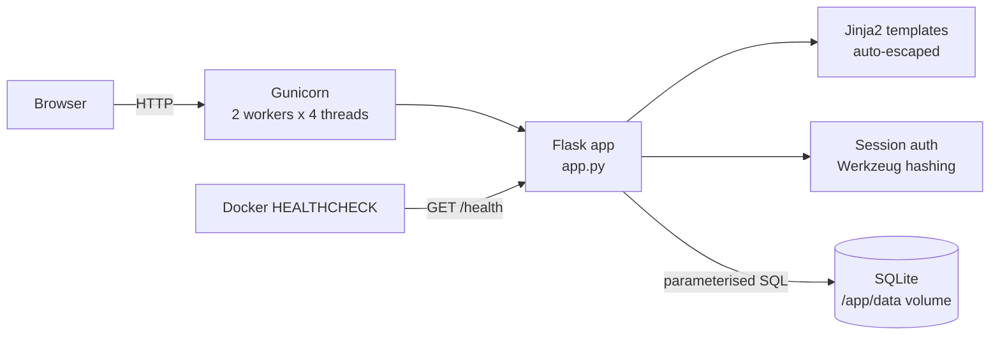
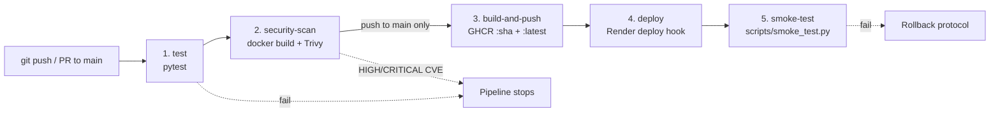

# CampusFind

**A campus lost-and-found web application delivered through an automated CI/CD and DevSecOps pipeline.**

CampusFind is a DevOps Lab mini-project. The web app is small but fully working. The main deliverable is the pipeline that tests, secures, packages, deploys and verifies it on every push.

---

## 1. Project Overview & Academic Purpose

**Problem.** Lost items on campus are reported through scattered WhatsApp groups, notice boards and security desks. Nobody can search them, nobody knows if an item was already returned, and finders cannot reach owners easily.

**Solution.** CampusFind is a central board. Students sign up, report *lost* or *found* items with category, location, date and contact email, then search and filter the board. Owners track each listing through `open → claimed → resolved`.

**Why DevOps is the core focus.** The evaluation targets the delivery process, not only the features:

| Practice | How CampusFind demonstrates it |
|---|---|
| Continuous Integration | 22 automated pytest tests run on every push and pull request |
| DevSecOps | Trivy scans the container image; HIGH/CRITICAL findings block the release |
| Continuous Delivery | Immutable image tagged with the commit SHA is pushed to GHCR |
| Continuous Deployment | Render deploy hook triggered automatically from `main` |
| Verification | Post-deploy smoke test checks `/health`, `/` and `/items/new` |
| Observability | `/health` endpoint plus Docker `HEALTHCHECK` |
| Secure runtime | Non-root container user (UID 10001), minimal runtime packages |

---

## 2. Architecture & Pipeline Diagrams

### Application architecture



### Request flow

```text
Browser ──► Gunicorn ──► Flask route ──► validate input ──► parameterised query ──► SQLite
                                   │                                                 │
                                   └──────────── render Jinja2 template ◄────────────┘
```

### 5-stage CI/CD + DevSecOps pipeline



```text
[1 test] ──► [2 security-scan] ──► [3 build-and-push] ──► [4 deploy] ──► [5 smoke-test]
 pytest       Trivy gate            GHCR :sha + :latest     Render hook     /health, /, /items/new
                                    (push to main only)
```

Pull requests run stages 1–2 only, so unmerged code is never published or deployed.

---

## 3. Technology Stack

| Component | Tool | Purpose | Rationale |
|---|---|---|---|
| Language | Python 3.11 | Application code | Readable, standard in teaching, well supported |
| Web framework | Flask 3.0 | Routing, sessions, templates | Lightweight; each line of the app is easy to explain |
| Templates | Jinja2 | Server-rendered HTML | Auto-escaping blocks XSS by default |
| Security | Werkzeug | Password hashing (`generate_password_hash`) | Salted, built-in, no extra dependency |
| Database | SQLite (stdlib `sqlite3`) | Persistent storage | Zero setup; file on a Docker volume in production |
| WSGI server | Gunicorn 23 | Production HTTP server | Multi-worker, multi-thread; replaces Flask dev server |
| Frontend | HTML5, vanilla CSS & JS | UI | No build step, no framework, fast to load |
| Testing | pytest 8 | Automated test suite | Fixtures give each test an isolated temp database |
| Container | Docker (`python:3.11-slim`, multi-stage) | Packaging | Same artifact runs locally, in CI and in production |
| CI/CD | GitHub Actions | Pipeline orchestration | Free for public repos, native to GitHub |
| DevSecOps | Trivy | Image vulnerability scanning | Free, fast, industry standard |
| Registry | GitHub Container Registry | Image storage | Authenticates with built-in `GITHUB_TOKEN` |
| Hosting | Render (free tier) | Live deployment | Deploy hook URL triggers redeploys from CI |

---

## 4. Local Quickstart (macOS & Linux)

```bash
# 1. Clone and enter the project
git clone https://github.com/<your-user>/<your-repo>.git
cd <your-repo>

# 2. Create a virtual environment and install dependencies
python3 -m venv .venv
source .venv/bin/activate
pip install -r requirements.txt

# 3. Create the database schema (also happens automatically on app start)
python database/init_db.py

# 4. Load demo data: 2 users and 12 realistic items
python scripts/seed_demo_data.py
#   add --reset to wipe items and re-seed

# 5. Run the development server
FLASK_ENV=development python app.py
#   open http://localhost:5000

# 6. Run the test suite
pytest
```

**Demo login:** `demo@campus.edu` / `DemoPassword123!` (a second user, `priya@campus.edu`, has the same password).

### Environment variables

| Variable | Default | Description |
|---|---|---|
| `SECRET_KEY` | `dev-insecure-change-me` | Signs session cookies. **Always set in production.** |
| `DATABASE_URL` | `sqlite:///campusfind.db` | SQLite location. Use `sqlite:////abs/path.db` for absolute paths. |
| `PORT` | `5000` | Port for `python app.py` |
| `FLASK_ENV` | `production` | `development`, `testing` or `production` |
| `SESSION_COOKIE_SECURE` | `false` | Set `true` when served over HTTPS |

---

## 5. Docker

```bash
# Build the image
docker build -t campusfind:local .

# Run it (data is lost when the container is removed)
docker run --rm -p 5000:5000 -e SECRET_KEY=demo campusfind:local

# Run with persistent data on a named volume
docker run -d --name campusfind -p 5000:5000 -e SECRET_KEY=demo -v campusfind-data:/app/data campusfind:local

# Seed demo data inside the running container
docker exec campusfind python scripts/seed_demo_data.py

# Inspect health
curl http://localhost:5000/health
docker inspect -f '{{.State.Health.Status}}' campusfind

# Confirm the container is not root
docker exec campusfind id      # uid=10001(appuser) gid=10001(appgroup)

# Scan locally with Trivy (same gate as CI)
docker run --rm -v /var/run/docker.sock:/var/run/docker.sock aquasec/trivy:latest \
  image --severity HIGH,CRITICAL --ignore-unfixed --exit-code 1 campusfind:local
```

**Image hardening:**
- Multi-stage build: wheels are built in a builder stage.
- Only Flask, Werkzeug and Gunicorn are installed in the runtime image. Test tools stay out.
- `pip`, `setuptools` and `wheel` are removed after install. They are unused at runtime and carry CVEs.
- `apt-get upgrade` picks up Debian security fixes, then apt lists are cleaned.
- The app runs as `appuser` (UID 10001), never as root.

---

## 6. GitHub Actions & Secrets Setup

The workflow lives in `.github/workflows/ci-cd.yml` and runs on every push and pull request to `main`.

1. **Push the repository to GitHub.** No setup is needed for stages 1–3. GHCR uses the built-in `GITHUB_TOKEN`.
2. **Allow package publishing:** repo → *Settings → Actions → General → Workflow permissions* → select **Read and write permissions**.
3. **Create the Render service:**
   1. render.com → *New → Web Service → Deploy an existing image* → `ghcr.io/<owner>/<repo>:latest`.
      If the package is private, make it public under GitHub → *Packages → Package settings*, or add registry credentials in Render.
   2. Add environment variables `SECRET_KEY` (random string) and `SESSION_COOKIE_SECURE=true`.
   3. Optional: add a persistent disk mounted at `/app/data`.
   4. *Settings → Deploy Hook* → copy the URL.
4. **Add repository secrets** (*Settings → Secrets and variables → Actions → New repository secret*):

| Secret | Example | Used by |
|---|---|---|
| `RENDER_DEPLOY_HOOK_URL` | `https://api.render.com/deploy/srv-xxxx?key=yyyy` | `deploy` job |
| `APP_URL` | `https://campusfind.onrender.com` | `smoke-test` job |

**Without secrets** (forks, first run), the `deploy` job does not fail. It prints a setup guide in the job summary. The `smoke-test` job then pulls the image it just published and runs it inside the runner, so the release artifact is still verified end to end.

---

## 7. 8-Step Live Faculty Demonstration

Before the demo: start Docker, run `python scripts/seed_demo_data.py`, open the GitHub *Actions* tab and the live Render URL in browser tabs.

1. **App tour (3 min).** Open the app. Show the statistics counters, search, and the filter dropdowns (they apply instantly). Log in as `demo@campus.edu`. Report an item, then open its detail page. Change the status to *claimed*, then *resolved*, and watch the counters update. Log in as `priya@campus.edu` and show that the owner controls are hidden. Visiting `/items/<id>/edit` directly returns **403**.
2. **Code change push.** Make a visible change, e.g. edit the hero text in `templates/index.html`. Then commit and push to `main`.
3. **CI test pass.** In *Actions*, open the run. Expand **1. Unit & integration tests** to show 22 passing tests.
4. **DevSecOps Trivy gate.** Expand **2. DevSecOps – Trivy image scan**. Show the report in the job summary and the downloadable `trivy-report` artifact. Explain that HIGH/CRITICAL findings fail this job and stop the release.
5. **Docker local run.** In a terminal: `docker build -t campusfind:local .`, then `docker run --rm -p 5000:5000 -e SECRET_KEY=demo campusfind:local`. Run `docker exec <id> id` to prove the container is non-root.
6. **Live deployment.** Show **3. Build & push** (image tagged with the commit SHA in GHCR), **4. Deploy** (Render hook) and **5. Smoke test** output. Refresh the live URL to see the change from step 2.
7. **Intentional test failure.** Break a rule, e.g. in `app.py` change `if not 3 <= len(data["title"]) <= 100:` to `<= 5`, then push. Stage 1 fails, and stages 2–5 are **skipped**, so nothing is deployed. Revert and push to return to green.
8. **Health verification.** Open `https://<app>/health`, or run `curl` against it, to show the JSON health report. Run `python scripts/smoke_test.py --url https://<app>` from a laptop. Show `docker inspect` reporting `healthy`.

---

## 8. Failure Handling & Rollback Protocol

| Failure point | Automatic behaviour | Effect on production |
|---|---|---|
| Tests fail | Pipeline stops at stage 1 | None – nothing built or deployed |
| Trivy finds HIGH/CRITICAL | Pipeline stops at stage 2 | None – image never pushed |
| Deploy hook returns non-2xx | `deploy` job fails | Render keeps the previous version |
| Smoke test fails | `smoke-test` job fails, run marked red | New version is live but broken – **roll back** |
| Runtime DB failure | `/health` returns 503, Docker marks container *unhealthy* | Orchestrator can restart it |

**Rollback procedure (smoke test failed after deploy):**

1. Find the last green run in *Actions* and copy its commit SHA.
2. **Fastest:** in Render → *Deploys*, click **Rollback** on the previous successful deploy.
   **Or** point the service image at the known-good immutable tag `ghcr.io/<owner>/<repo>:<good-sha>` and redeploy.
3. Verify the rollback: `python scripts/smoke_test.py --url https://<app>` must report `3/3 checks passed`.
4. Fix forward: `git revert <bad-sha>` and push. The full pipeline re-runs and redeploys a clean `latest`.
5. Record the incident: failing check, cause, time to recovery.

Every image is tagged with its commit SHA and never overwritten, so any earlier release can be redeployed exactly.

---

## Project Structure

```text
.
├── .github/workflows/ci-cd.yml   # 5-stage CI/CD + DevSecOps pipeline
├── app.py                        # Flask app factory, routes, validation, /health
├── config.py                     # Development / Testing / Production config
├── database/
│   ├── schema.sql                # DDL with CHECK constraints
│   └── init_db.py                # Schema initialisation
├── templates/                    # Jinja2 pages (+ _macros.html, error.html)
├── static/css/style.css          # Responsive design-token based styles
├── static/js/main.js             # Nav toggle, flash dismiss, live filters, confirm dialogs
├── scripts/
│   ├── seed_demo_data.py         # Demo users + 12 items
│   └── smoke_test.py             # Post-deploy HTTP verification
├── tests/                        # 22 pytest tests, isolated temp DB per test
├── Dockerfile                    # Multi-stage, non-root, HEALTHCHECK, Gunicorn
├── requirements.txt              # Pinned dependencies
└── pytest.ini
```

## Endpoints

| Method | Path | Auth | Description |
|---|---|---|---|
| GET | `/` | – | Board with stats, search (`q`), filters (`category`, `type`, `status`), pagination (`page`) |
| GET/POST | `/register` | – | Create account |
| GET/POST | `/login` | – | Log in (email or username) |
| GET | `/logout` | – | Log out |
| GET/POST | `/items/new` | Login | Report an item |
| GET | `/items/<id>` | – | Item detail |
| GET/POST | `/items/<id>/edit` | Owner | Edit item and status |
| POST | `/items/<id>/status` | Owner | Quick status change |
| POST | `/items/<id>/delete` | Owner | Delete item |
| GET | `/health` | – | `200 healthy` / `503 unhealthy` JSON |

## Security Notes

- All SQL uses `?` placeholders. User input is never concatenated into queries.
- Passwords are stored only as Werkzeug salted hashes.
- Jinja2 auto-escaping is on. A test verifies that `<script>` payloads render escaped.
- Session cookies are `HttpOnly` and `SameSite=Lax`. Set `SESSION_COOKIE_SECURE=true` behind HTTPS.
- The login `next` parameter only accepts local paths, which prevents open redirects.
- Image URLs must be `http(s)://`, which blocks `javascript:` URLs.
- The database enforces `CHECK` constraints on category, type, status and lengths, in addition to the application validation.
